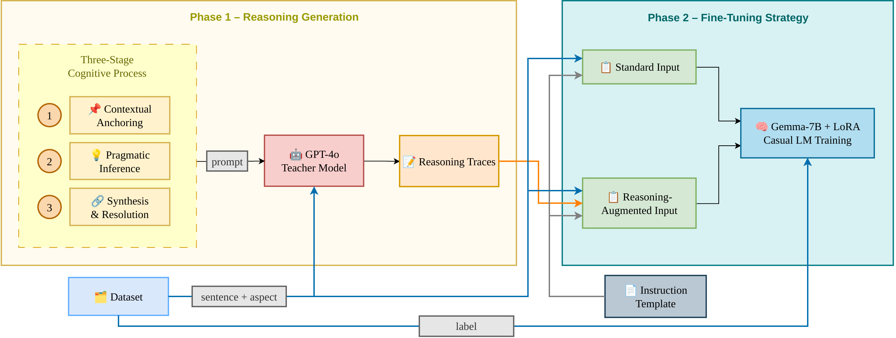

# ReasonTune-ISA

Research code and saved predictions for **Investigating the Role of Reasoning Augmentation in Parameter-Efficient Fine-Tuning for Implicit Sentiment Analysis**.

**ATAC 2026 · Accepted · Oral presentation delivered**
[Manuscript](https://drive.google.com/file/d/1ISDo2Vxnub7e98TCMxbe92PE17-26XiK/view) · [Training notebooks](#reproduce) · [Saved results](#results)

## Study

We compare standard and reasoning-augmented **LoRA fine-tuning of Gemma-7B** on the Restaurant and Laptop domains of SemEval-2014, using the implicit-sentiment annotations described in the manuscript.

- **Standard** inputs contain the sentence and target aspect.
- **Reasoning-augmented** inputs also contain GPT-4o-generated linguistic rationales at both training and inference time. Rationale generation uses the sentence and aspect, without the gold sentiment label.
- Both settings use BF16 base weights, LoRA rank 64, alpha 128, dropout 0.1, four epochs, and a learning rate of `2e-4`.



*Color version of the framework. The camera-ready manuscript uses a grayscale version to meet conference requirements.*

## Results

Saved implicit-subset accuracy, reproduced from the prediction CSVs without running model inference.

| Setting | Restaurant ISA (267 examples) | Laptop ISA (175 examples) |
| --- | ---: | ---: |
| Standard LoRA | **75.28%** | **81.14%** |
| Reasoning-augmented LoRA | 74.53% | 76.00% |

These results highlight the limits of reasoning augmentation on the implicit subsets, with a larger accuracy decrease in the Laptop domain.

The reasoning setting uses teacher-generated rationales during inference. Reported scores correspond to the archived prediction files and the evaluation protocol in the notebooks.

## Reproduce

The notebooks target **Google Colab with an NVIDIA A100** and Google Drive storage. Local execution requires adapting the `/content/drive/MyDrive/ATAC2026/` paths.

1. Obtain Hugging Face access to `google/gemma-7b` and provide your token through your runtime's secret store.
2. Open either notebook below and review its installation and path-configuration cells.
3. Run training, inference, and evaluation in order. Existing predictions and reports can also be inspected directly.

| Entry point | Purpose |
| --- | --- |
| [`ISA_Standard_FineTuning_Gemma.ipynb`](ISA_Standard_FineTuning_Gemma.ipynb) | Standard LoRA training and evaluation |
| [`ISA_Reasoning_FineTuning_Gemma.ipynb`](ISA_Reasoning_FineTuning_Gemma.ipynb) | Rationale generation, augmented training, and evaluation |

The reasoning notebook can use the supplied rationale CSVs. Generating new rationales requires Azure OpenAI access and incurs API charges. Configure its Azure client cells before execution.

**Reproduction note.** Library versions, GPU runtimes, and hosted model deployments evolve over time. New runs may produce different results, particularly when regenerating rationales. Use the supplied rationales and archived predictions to inspect the reported experiments in their original form.

### Prompting baseline

The included runner supports Azure OpenAI deployments with zero-shot, few-shot, and CoT-style prompts. Set `AZURE_OPENAI_KEY`, `AZURE_OPENAI_ENDPOINT`, and `AZURE_OPENAI_API_VERSION` in the environment.

```bash
pip install pandas scikit-learn openai
python baselines/run_baseline.py \
  --input data/reasoning_augmented/laptop_test_reasoning.csv \
  --output baseline_results/laptop_zero_shot.csv \
  --prompt-type zero-shot \
  --model YOUR_AZURE_DEPLOYMENT
```

The runner consumes the sentence and aspect columns and provides the Azure OpenAI prompting workflow. See the manuscript for the complete set of model comparisons.

## Repository map

| Directory | Contents |
| --- | --- |
| `data/` | Annotated XML splits and rationale-augmented CSVs |
| `baselines/` | Prompt templates and Azure OpenAI runners |
| `inference_results/` | Saved standard and reasoning-augmented predictions |
| `evaluation_results/` | Overall, explicit-subset, and implicit-subset metrics |
| `assets/` | Framework figure for this README |

The manuscript contains the methodology and dataset references. Proceedings and a DOI are pending.

## License

The repository includes an [MIT license](LICENSE). Consult the original sources for terms governing third-party datasets and model weights.
